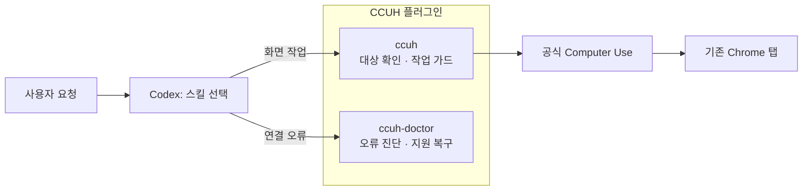

# CCUH

**Codex Computer Use Helpers**

Codex 플러그인으로 설치하는 Computer Use 보조 스킬셋입니다.

[English](README.md) | [한국어](README.ko.md)

> [!NOTE]
> macOS · Chrome 환경의 프리뷰입니다.

## 프로젝트 소개

Codex에 **등록된 CCUH 플러그인을 추가하면** 두 스킬과 실행 스크립트가 함께 설치됩니다.

- **ccuh:** 기존 Chrome 탭 재사용, 대상 확인, 불확실한 작업 중단.
- **ccuh-doctor:** 연결 오류 진단, 지원되는 복구, 상태 확인 후 승인된 Codex 재시작.

Codex가 요청에 맞는 `SKILL.md` 지침을 읽고 동봉된 스크립트를 실행합니다. 실제 화면 조작에는 공식 Computer Use를 사용합니다.

**사용:** 플러그인 추가 후 새 채팅에서 Chrome을 선택하고, “`ccuh`로 기존 `[URL]` 탭에서 …을 변경해줘”처럼 요청하세요.

**필요 환경:** macOS · Chrome Computer Use 연결. Doctor에는 Python 3.9 이상이 필요합니다.

적용 범위는 이 스킬을 통해 수행한 작업입니다. 모든 환경에서의 포커스·Space 보존과 무관 화면 수집 차단은 보장하지 않습니다. [검증 범위](VERIFICATION.json)

## 라이선스

[MIT](LICENSE)
