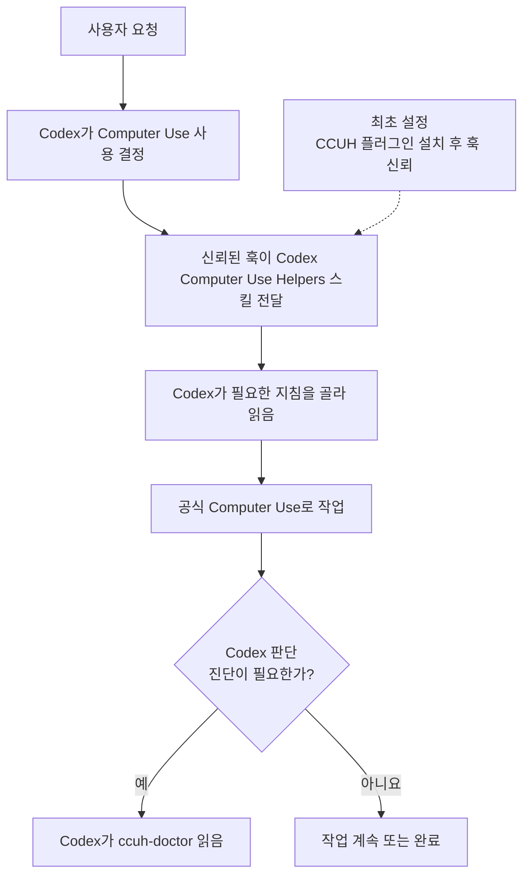

<div align="center">

# CCUH

**Codex Computer Use Helpers**

[English](README.md) | **한국어**

</div>

## 프로젝트 소개

CCUH는 Codex 데스크톱에서 작업 대상과 입력 방법을 확인하도록 돕는 두 가지 스킬입니다.\
공식 Computer Use가 화면을 조작하고, CCUH는 오류나 불확실한 결과에 대처할 방법을 안내합니다.

## 기능 안내

<table>
  <thead>
    <tr>
      <th>기능</th>
      <th>적용 방식</th>
    </tr>
  </thead>
  <tbody>
    <tr>
      <td><a href="#설치">자동 연동</a></td>
      <td>신뢰한 훅이 지원되는 Computer Use 호출 전에 CCUH 지침을 불러옵니다.</td>
    </tr>
    <tr>
      <td><a href="skills/codex-computer-use-helpers/references/target.md">작업 대상</a></td>
      <td>
        <details>
          <summary>앱, 탭과 창 상태</summary>
          <div><strong>기존 앱과 창 재사용</strong> — 이미 열려 있는 앱이나 문서를 요청하면 해당 창과 문서를 확인한 뒤 재사용합니다.</div>
          <div><strong>브라우저 탭 탐색과 재탐색</strong> — 공식 조회로 요청한 탭을 찾고, 탭 부재와 연결 끊김을 구분합니다.</div>
          <div><strong>대상 범위와 결과 확인</strong> — 관찰과 조작 전후에 요청한 대상과 범위가 유지되는지 살피고, 요청한 결과가 반영됐는지 확인합니다.</div>
          <div><strong>창 상태와 지원 여부 확인</strong> — 숨김, 최소화, 다중 창 등 현재 창 상태에서 요청한 작업이 지원되는지 확인합니다.</div>
        </details>
      </td>
    </tr>
    <tr>
      <td><a href="skills/codex-computer-use-helpers/references/user-work-protection.md">사용자 작업 보호</a></td>
      <td>
        <details>
          <summary>백그라운드 입력과 포커스</summary>
          <div><strong>백그라운드 입력 경로 선택</strong> — 현재 창에서 지원되는 입력 방법 중 사용자 작업을 방해하지 않는 경로를 고릅니다.</div>
          <div><strong>비활성 창의 클릭과 스크롤</strong> — 조작 전에 공식 도구가 해당 창에서 동작을 지원하는지, 사용자 입력에 간섭할 수 있는지 확인합니다.</div>
          <div><strong>포커스와 입력 간섭 대응</strong> — 실제 간섭이나 사용자 중단 신호가 확인되면 후속 조작을 멈추고 작업 상태를 확인합니다.</div>
        </details>
      </td>
    </tr>
    <tr>
      <td><a href="skills/codex-computer-use-helpers/references/input-target.md">입력 대상</a></td>
      <td>클릭하거나 입력하기 직전에 최신 관측을 사용하고, 화면이 바뀌면 버튼이나 입력칸을 다시 찾습니다.</td>
    </tr>
    <tr>
      <td><a href="skills/codex-computer-use-helpers/references/execution-state.md">실행 상태</a></td>
      <td>
        <details>
          <summary>실행 주체와 변경 상태</summary>
          <div><strong>일반 앱의 실행 주체 확인</strong> — UI 작업을 시작하기 전에 현재 호스트가 허용한 작업 채팅과 실행 주체를 확인합니다.</div>
          <div><strong>중복 연결과 동시 입력 관리</strong> — 선택한 연결을 재사용하고, 충돌하는 변경은 도구의 점유 상태를 확인해 순서대로 처리합니다.</div>
          <div><strong>결과가 불명확한 변경 보호</strong> — 변경의 성공 여부가 불명확하면 재전송을 보류하고 공식 경로로 상태를 확인합니다.</div>
          <div><strong>정상 종료와 재연결</strong> — 작업 결과를 확인한 뒤 공식 절차로 정리하고, 연결 끊김이 확인되면 공식 절차로 복구합니다.</div>
        </details>
      </td>
    </tr>
    <tr>
      <td><a href="skills/ccuh-doctor/SKILL.md">CCUH Doctor</a></td>
      <td>
        <details>
          <summary>오류 확인과 복구</summary>
          <div><strong>오류 확인</strong> — 공식 도구의 오류와 상태를 읽어 초기화, 인증, 권한, 연결과 대상 문제를 구분합니다.</div>
          <div><strong>복구</strong> — Codex는 기존 승인 범위에서 재연결 등 지원되는 절차를 따릅니다. 본인 인증이나 직접 승인이 필요한 단계는 사용자가 진행합니다.</div>
          <div><strong>중복 제출 방지 예시</strong> — 제출 버튼을 누른 뒤 응답 시간이 초과되면 같은 페이지에서 제출 여부를 확인합니다. 결과가 불명확하면 다시 제출하지 않습니다.</div>
        </details>
      </td>
    </tr>
  </tbody>
</table>

## 작동 원리

자동 연동 훅을 설치하고 신뢰하면, CCUH를 따로 부르지 않아도 지원되는 Computer Use 호출 전에 훅이 `codex-computer-use-helpers` 진입 스킬을 Codex에 전달합니다. Codex는 진입 스킬의 기준에 따라 작업에 필요한 지침을 골라 읽고 공식 Computer Use로 작업합니다. 진단이 필요하다고 판단할 때만 `ccuh-doctor` 지침을 읽습니다.



## 설치

CCUH 플러그인을 설치하면 `codex-computer-use-helpers`와 `ccuh-doctor` 스킬, 자동 연동 훅이 함께 설치됩니다. macOS용 Codex 데스크톱에서 공식 Computer Use를 활성화하고 앱에서 `node`를 실행할 수 있는지 확인하세요. Codex CLI가 있는 터미널에 아래 한 줄을 붙여 넣으세요.

```sh
codex plugin marketplace add Package-KR/CCUH --ref main && codex plugin add CCUH@CCUH
```

마켓플레이스는 최신 공개 릴리스를 가리킵니다. Codex는 이 목록을 사용해 설치본을 갱신합니다. `ccuh@ccuh-preview`를 설치한 적이 있다면 Codex에서 이전 마켓플레이스를 제거한 뒤 위 명령으로 CCUH를 다시 추가하세요.

설치 후 **설정 → Hooks**에서 CCUH 훅을 검토하고 신뢰한 뒤 기존 채팅에서 계속 작업하세요. 지원되는 Computer Use 호출에 CCUH가 자동으로 적용되지 않을 때만 새 채팅을 여세요.

## 사용

기본 모드에서는 현재 환경에서 사용자의 작업을 방해하지 않는 방법을 고릅니다. 작업 창을 보려면 요청에 “작업 중인 창도 보여줘”를 덧붙이세요. 창 표시와 백그라운드 입력 범위는 대상 앱과 Codex 환경의 지원 여부에 따릅니다.

## 라이선스

[MIT](LICENSE)
