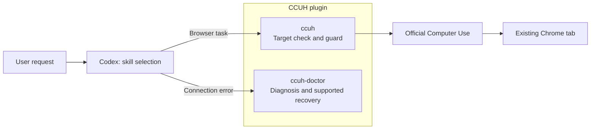

# CCUH

**Codex Computer Use Helpers**

A Codex plugin for existing Chrome tab workflows and supported Computer Use recovery.

[English](README.md) | [한국어](README.ko.md)

<!-- ccuh-current-preview -->
> **CCUH 0.1.0 Preview**
> Get the current Computer Use plugin with automatic hooks from the [release branch](https://github.com/dijeungi/CCUH/tree/release), or [download the ZIP](https://github.com/dijeungi/CCUH/archive/refs/heads/release.zip). The release branch includes installation instructions.

## About

CCUH is a **Codex plugin** containing two skills and executable helper scripts. Adding the plugin installs both:

- **ccuh:** Finds an existing Chrome tab by exact URL and guards supported actions through the host's documented browser Computer Use API.
- **ccuh-doctor:** Diagnoses selected connection errors, supports reversible CLI repairs, and can restart Codex with approval after checkpoint and idle-work checks.

**How it works.** Codex selects a skill, reads its `SKILL.md`, and runs the bundled helper scripts. The plugin does not patch Codex or intercept every Computer Use call.

**Add and use.** Add the registered CCUH plugin to Codex. In a new chat, select Chrome and ask:

> Use ccuh to update … in the existing https://example.com/settings tab; stop if supported background control is unavailable.

**Requirements.** macOS and a working Chrome Computer Use connection in the current chat. Doctor requires Python 3.9+. [Official Chrome setup](https://learn.chatgpt.com/docs/chrome-extension)

**Preview limits.** CCUH cannot lock OS focus or Spaces, or guarantee atomic capture/input that prevents unrelated content collection. Supported test cases and compatibility limits are recorded in [VERIFICATION.json](VERIFICATION.json).

## License

[MIT](LICENSE)
