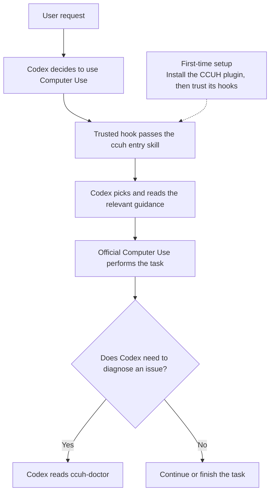

<div align="center">

# CCUH

**Codex Computer Use Helpers**

**English** | [한국어](README.ko.md)

</div>

## About

CCUH provides two skills that help Codex confirm the target and input method for Computer Use tasks and respond to errors or unclear outcomes. The official Computer Use tool in Codex desktop performs the UI actions.

## Features

<table>
  <thead>
    <tr>
      <th>Feature</th>
      <th>What it does</th>
    </tr>
  </thead>
  <tbody>
    <tr>
      <td><a href="#installation">Automatic integration</a></td>
      <td>A trusted hook loads CCUH guidance before supported Computer Use calls.</td>
    </tr>
    <tr>
      <td><a href="skills/ccuh/references/target.md">Work target</a></td>
      <td>
        <details>
          <summary>Apps, tabs, and windows</summary>
          <div><strong>Reuse open apps and windows</strong> — Confirm and reuse the requested window or document when it is already open.</div>
          <div><strong>Find and rediscover browser tabs</strong> — Use the official lookup to find the requested tab and distinguish a missing tab from a lost connection.</div>
          <div><strong>Verify scope and outcome</strong> — Check the requested target and scope before and after observing or acting, and confirm the requested effect.</div>
          <div><strong>Check window state and support</strong> — Confirm that the requested action is supported in the current window state, such as a hidden or minimized window or an app with multiple windows.</div>
        </details>
      </td>
    </tr>
    <tr>
      <td><a href="skills/ccuh/references/user-work-protection.md">User work protection</a></td>
      <td>
        <details>
          <summary>Background input and focus</summary>
          <div><strong>Choose a background input method</strong> — Use an input method supported by the current window that avoids interfering with the user's work.</div>
          <div><strong>Click and scroll in inactive windows</strong> — Check whether the official tool supports the action in that window and whether it could interfere with the user's input.</div>
          <div><strong>Respond to focus and input interference</strong> — Stop further actions and check the task state when actual interference or a user interruption is confirmed.</div>
        </details>
      </td>
    </tr>
    <tr>
      <td><a href="skills/ccuh/references/input-target.md">Input target</a></td>
      <td>Use the latest observation before clicking or typing. Find the button or field again when the UI changes.</td>
    </tr>
    <tr>
      <td><a href="skills/ccuh/references/execution-state.md">Execution state</a></td>
      <td>
        <details>
          <summary>Execution and change status</summary>
          <div><strong>Check who can operate native apps</strong> — Before starting UI work, check which chat and agent the host allows to act.</div>
          <div><strong>Manage duplicate connections and concurrent input</strong> — Reuse the selected connection, check whether the tool is busy, and handle conflicting changes sequentially.</div>
          <div><strong>Protect changes with unclear outcomes</strong> — Hold off on resending the change and check its status through an official route.</div>
          <div><strong>Clean up and reconnect</strong> — Verify the outcome before following the official cleanup procedure. Use the official recovery procedure when a disconnect is confirmed.</div>
        </details>
      </td>
    </tr>
    <tr>
      <td><a href="skills/ccuh-doctor/SKILL.md">CCUH Doctor</a></td>
      <td>
        <details>
          <summary>Errors and recovery</summary>
          <div><strong>Check the error</strong> — Use official tool errors and state to distinguish initialization, authentication, permission, connection, and target issues.</div>
          <div><strong>Recover</strong> — Codex uses supported procedures such as reconnecting within existing approvals. The user handles steps that require them, such as identity verification or granting permission.</div>
          <div><strong>Duplicate submission example</strong> — If the response times out after clicking Submit, check whether the same page shows a successful submission. If the outcome remains unclear, do not submit again.</div>
        </details>
      </td>
    </tr>
  </tbody>
</table>

## How it works

When automatic integration is installed and trusted, a CCUH hook passes the `ccuh` entry skill to Codex before supported Computer Use calls, even if your request omits CCUH. Codex uses the entry skill's criteria to pick and read the relevant guidance, then works through official Computer Use. Codex reads `ccuh-doctor` only when it determines that diagnosis is needed.



## Installation

The CCUH plugin installs both `ccuh` and `ccuh-doctor` along with the automatic integration hooks. On macOS, enable official Computer Use in Codex desktop and make sure the app can run `node`. Paste this line into a terminal with the Codex CLI.

```sh
codex plugin marketplace add Package-KR/CCUH --ref main && codex plugin add ccuh@ccuh-preview
```

The marketplace points to the latest published CCUH release. Codex uses it to update installed copies. If your marketplace is pinned to a tag from an earlier install, run only the part before `&&` once to switch it to `main`.

After installation, review and trust the CCUH hooks in **Settings → Hooks** and continue in your existing chat. Open a new chat only if CCUH doesn't load automatically for a supported Computer Use call.

## Usage

In default mode, CCUH selects a method that avoids interfering with your work in the current environment. To watch the work, add “Show me the window you're working in” to your request. Window visibility and background input depend on what the target app and Codex environment support.

## License

[MIT](LICENSE)
